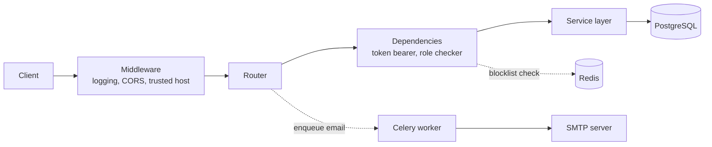

# Architecture

## Layers

The application follows a layered structure. Each feature module (`auth`, `books`, `reviews`, `tags`) contains the same three layers.

| Layer | Responsibility | Files |
|---|---|---|
| Routes | HTTP handling, dependency wiring, status codes | `routes.py` (`routers.py` in `auth`) |
| Schemas | Request/response validation and serialization (Pydantic) | `schemas.py` |
| Service | Business logic and database access | `service.py` |

Shared infrastructure lives at the package root and in `db/`.

## Request lifecycle



## Package layout

```
backend/
├── src/
│   ├── __init__.py        Application factory, lifespan, router registration
│   ├── config.py          Settings (pydantic-settings) and Celery configuration
│   ├── constants.py       Token lifetimes and other fixed values
│   ├── errors.py          Exception classes and global handlers
│   ├── middleware.py      Request logging, CORS, trusted hosts
│   ├── mail.py            FastAPI-Mail setup and message factory
│   ├── celery_tasks.py    Celery application and email task
│   ├── auth/              Users, tokens, roles
│   ├── books/             Book CRUD
│   ├── reviews/           Book reviews
│   ├── tags/              Tags and book-tag association
│   ├── db/                Engine/session, models, Redis client
│   └── templates/         HTML email templates
├── migrations/            Alembic migration scripts
├── docs/                  Backend technical docs (this folder)
└── README.md
```

Router registration and startup behaviour are documented in [Infrastructure — Application entry point](infrastructure.md#application-entry-point-src__init__py).
