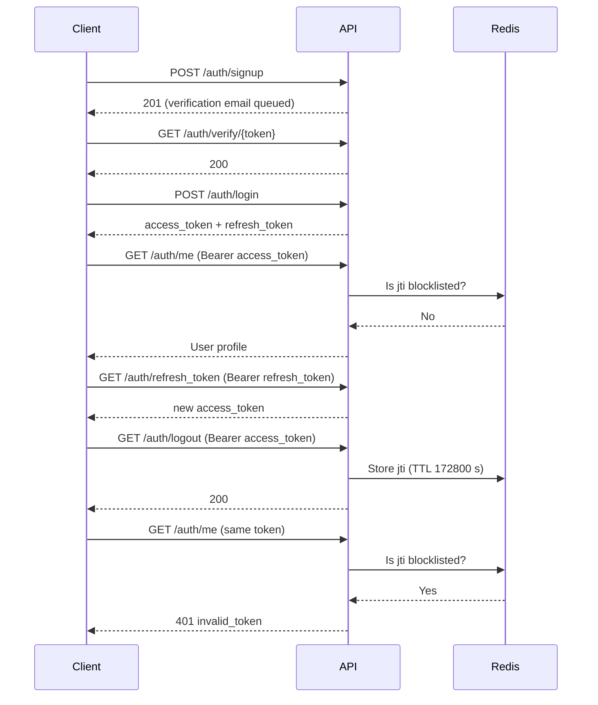

# Authentication and Authorization

## Token model

| Token | Lifetime | Purpose | Accepted by |
|---|---|---|---|
| Access token | 15 minutes | Authorize API calls | `AccessTokenBearer` |
| Refresh token | 2 days | Obtain a new access token | `RefreshTokenBearer` (`GET /auth/refresh_token` only) |

Both are signed JWTs. Payload structure:

```json
{
  "user": { "email": "jane@example.com", "user_uid": "b3c1...", "role": "user" },
  "exp": 1234567890,
  "jti": "uuid4-string",
  "refresh": false
}
```

The `jti` (unique token ID) enables revocation. The `refresh` flag distinguishes the two token types.

## Token lifecycle



## Request authentication (`src/auth/dependencies.py`)

**`TokenBearer(HTTPBearer)`** is the base class. On each request it:

1. Extracts the bearer token from the `Authorization` header.
2. Decodes it with `decode_token()`; raises `InvalidToken` if invalid or expired.
3. Checks the `jti` against the Redis blocklist; raises `InvalidToken` if present.
4. Calls the subclass hook `verify_token_data()`.

| Class | Behaviour |
|---|---|
| `AccessTokenBearer` | Raises `AccessTokenRequired` if the token is a refresh token. Used on all regular protected routes. |
| `RefreshTokenBearer` | Raises `RefreshTokenRequired` if the token is not a refresh token. Used only on `GET /auth/refresh_token`. |

**`get_current_user(token_details, session)`** loads the user identified by the token's email and returns the `User` object. It raises HTTP 404 if the user no longer exists.

**`RoleChecker(allowed_roles)`** is a callable dependency:

```python
role_checker = Depends(RoleChecker(["admin", "user"]))
```

It resolves the current user, then raises `AccountNotVerified` if `is_verified` is `False`, and `InsufficientPermission` if the user's role is not in `allowed_roles`.

## Roles

| Role | Permissions |
|---|---|
| `user` | Browse, create, update, and delete books; submit reviews; manage tags |
| `admin` | All user permissions, plus list/delete users, change roles, send broadcast emails, create admin accounts |

## Password hashing and email tokens (`src/auth/utils.py`)

| Function | Description |
|---|---|
| `generate_password_hash(passwd) -> str` | Argon2 hash via Passlib |
| `verify_password(password, hashed_password) -> bool` | Verify a password against its hash |
| `create_access_token(user_data, expiry, refresh)` | Create a signed JWT (adds `exp`, `jti`, `refresh`) |
| `decode_token(token)` | Verify and decode a JWT; returns the payload or `None` |
| `create_url_safe_token(data)` | Sign a dict into a URL-safe string (`itsdangerous`, salt `email-configuration`) |
| `decode_url_safe_token(token)` | Verify signature and age (max 1 hour); returns `None` on failure |

See also: [Auth API](api/auth.md), [Infrastructure — Redis](infrastructure.md#redis-srcdbredispy).
