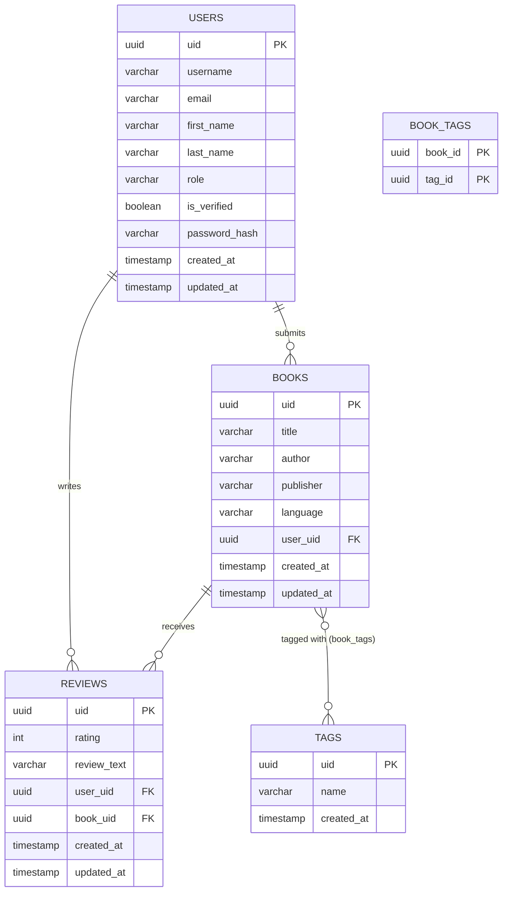

# Data Model

## Entity relationships

## Tables (`src/db/models.py`)

Models are defined with SQLModel using PostgreSQL column types.

### `users`

| Column | Type | Notes |
|---|---|---|
| `uid` | UUID | Primary key, auto-generated |
| `username`, `email`, `first_name`, `last_name` | VARCHAR | |
| `role` | VARCHAR | Default `"user"` |
| `is_verified` | BOOLEAN | Default `False` |
| `password_hash` | VARCHAR | Excluded from serialization |
| `created_at`, `updated_at` | TIMESTAMP | Set to `datetime.now()` |

Relationships: `books` and `reviews`, both eagerly loaded (`selectin`).

### `books`

| Column | Type | Notes |
|---|---|---|
| `uid` | UUID | Primary key |
| `title`, `author`, `publisher`, `language` | VARCHAR | |
| `user_uid` | UUID | FK to `users.uid`, nullable |
| `created_at`, `updated_at` | TIMESTAMP | |

Relationships: `user`, `reviews` (eager), `tags` through `book_tags` (eager).

### `reviews`

| Column | Type | Notes |
|---|---|---|
| `uid` | UUID | Primary key |
| `rating` | INTEGER | Check constraint: `1 <= rating <= 5` |
| `review_text` | VARCHAR | |
| `user_uid` | UUID | FK to `users.uid`, nullable |
| `book_uid` | UUID | FK to `books.uid`, nullable |
| `created_at`, `updated_at` | TIMESTAMP | |

### `tags`

| Column | Type | Notes |
|---|---|---|
| `uid` | UUID | Primary key |
| `name` | VARCHAR | |
| `created_at` | TIMESTAMP | |

Relationship: `books` through `book_tags` (eager).

### `book_tags` (join table)

| Column | Type | Notes |
|---|---|---|
| `book_id` | UUID | FK to `books.uid`, part of composite PK |
| `tag_id` | UUID | FK to `tags.uid`, part of composite PK |

## Migrations

Schema changes are managed with Alembic (`alembic revision --autogenerate`, `alembic upgrade head`). When `ENV != production`, tables are also created at startup with `init_db()`. In production, run `alembic upgrade head` before starting the server and skip `init_db()`.
